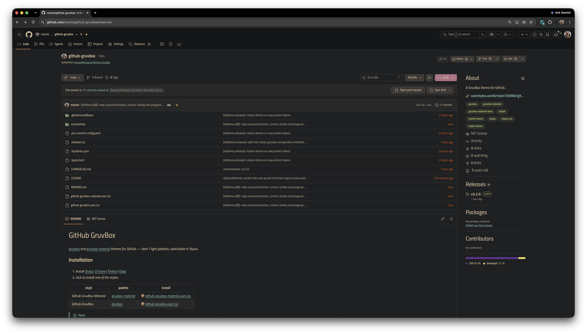
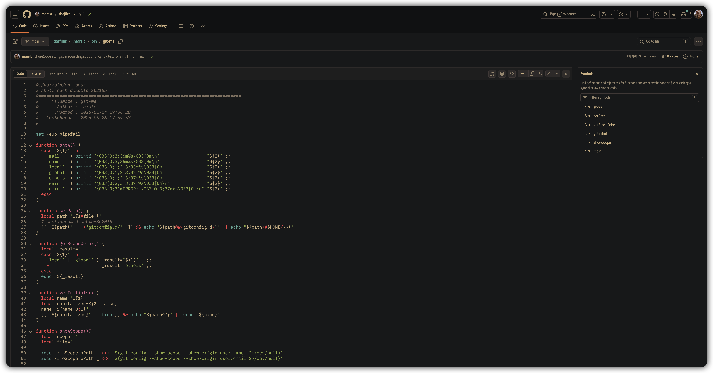
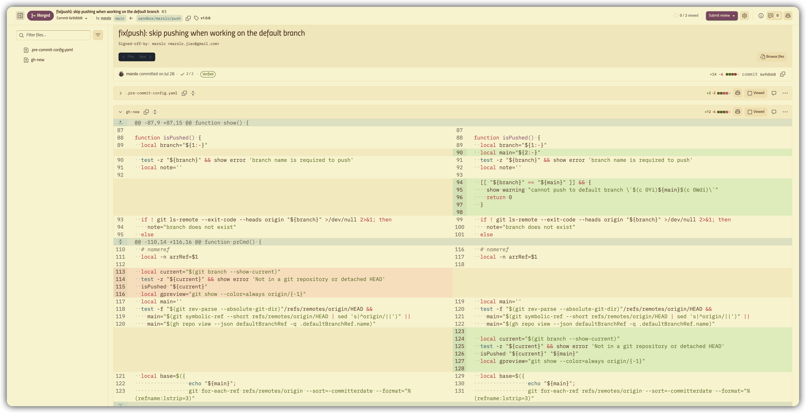
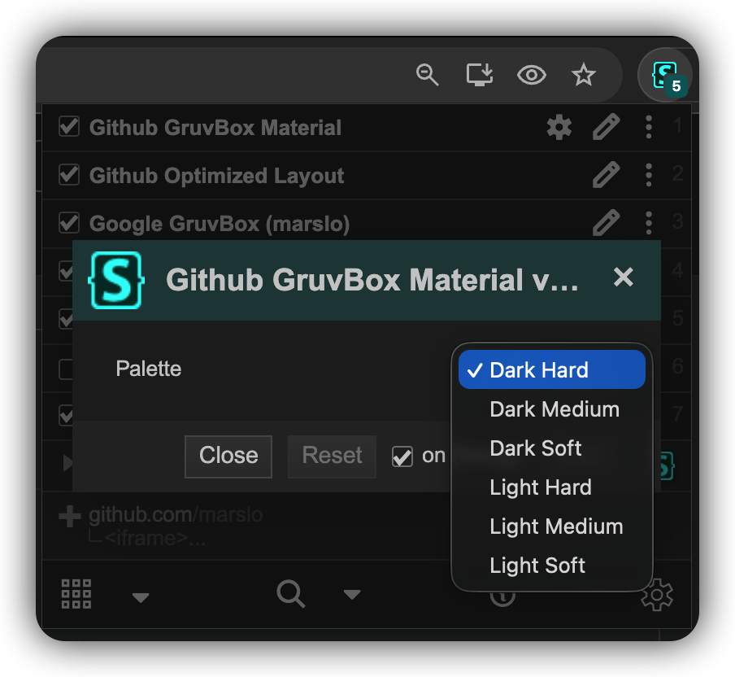

# GitHub GruvBox

[gruvbox](https://github.com/morhetz/gruvbox) and [gruvbox-material](https://github.com/sainnhe/gruvbox-material) themes for GitHub — dark / light palettes, switchable in Stylus.

|                                  REPO<br>gruvbox-material (dark hard)                                 |                                  CODE<br>gruvbox-material (dark hard)                                 |                                  DIFF<br>gruvbox-material (light hard)                                |
| :---------------------------------------------------------------------------------------------------: | :---------------------------------------------------------------------------------------------------: | :---------------------------------------------------------------------------------------------------: |
| [](https://github.com/marslo/github-gruvbox/raw/main/screenshots/repo.png) | [](https://github.com/marslo/github-gruvbox/raw/main/screenshots/code.png) | [](https://github.com/marslo/github-gruvbox/raw/main/screenshots/diff.png) |

## Installation

1. install [Stylus](https://github.com/openstyles/stylus): [Chrome](https://chromewebstore.google.com/detail/stylus/clngdbkpkpeebahjckkjfobafhncgmne) | [Firefox](https://addons.mozilla.org/firefox/addon/styl-us/) | [Edge](https://microsoftedge.microsoft.com/addons/detail/stylus/dmcfbglnmkadeibaoelljihicilhlnjd)
2. click to install one of the styles:

| style | palette | install |
|---|---|---|
| Github GruvBox Material | [gruvbox-material](https://github.com/sainnhe/gruvbox-material) | 📦 [github-gruvbox-material.user.css](https://github.com/marslo/github-gruvbox/raw/main/github-gruvbox-material.user.css) |
| Github GruvBox Redux | [gruvbox](https://github.com/morhetz/gruvbox) | 📦 [github-gruvbox.user.css](https://github.com/marslo/github-gruvbox/raw/main/github-gruvbox.user.css) |

> [!NOTE]
> Enable only one of them at a time — both override the same tokens.

## Palettes

Switch in Stylus: style ⚙ **Configure** → `Palette`.



### Github GruvBox Material

| `Palette` | background | foreground |
|---|---|---|
| `Dark Hard` ( default ) | `#1d2021` | `#d4be98` |
| `Dark Medium` | `#282828` | `#d4be98` |
| `Dark Soft` | `#32302f` | `#d4be98` |
| `Light Hard` | `#f9f5d7` | `#654735` |
| `Light Medium` | `#fbf1c7` | `#654735` |
| `Light Soft` | `#f2e5bc` | `#654735` |

### Github GruvBox Redux

| `Palette` | background | foreground |
|---|---|---|
| `Dark` ( default ) | `#282828` | `#ebdbb2` |
| `Light` | `#fbf1c7` | `#3c3836` |

## Features

- recolors GitHub via its [Primer](https://primer.style/) design tokens: backgrounds, text, borders, buttons, inputs, overlays, diffs, contribution graph, code view, syntax highlighting
- works with any GitHub appearance setting ( light / dark / soft dark / sync with system )
- covers `github.com` and its subdomains ( e.g. `gist.github.com` )
- accents:

  | element | color |
  |---|---|
  | links | blue |
  | secondary text | grey |
  | topic tags | green |
  | primary buttons | purple |

## Development

| file | description |
|---|---|
| `github-gruvbox.user.css` | classic gruvbox palette |
| `github-gruvbox-material.user.css` | gruvbox-material palette |
| `.releaserc.js` | semantic-release: bumps `@version` in both styles, updates `CHANGELOG.md` |
| `.pre-commit-config.yaml` | stylelint, typos, whitespace checks |

- both styles share everything below the palette block — edit them together, then check only the palette differs:

  ```bash
  diff github-gruvbox.user.css github-gruvbox-material.user.css
  ```

- palettes are `@var select palette` options expanded by the Stylus `uso` preprocessor into an `html:root { … }` override

> [!IMPORTANT]
> Option values must not contain `*/` — it closes the `==UserStyle==` metadata comment early.

## Credits

- `github-gruvbox.user.css` ( Redux ): based on the original [GitHub GruvBox](https://github.com/marslo/github-gruvbox/commit/8c228be0) by Sam McGowan, enhanced by Marslo Jiao
- `github-gruvbox-material.user.css`: original work by Marslo Jiao
- palettes: [morhetz/gruvbox](https://github.com/morhetz/gruvbox), [sainnhe/gruvbox-material](https://github.com/sainnhe/gruvbox-material)
- [MIT License](./LICENSE)
